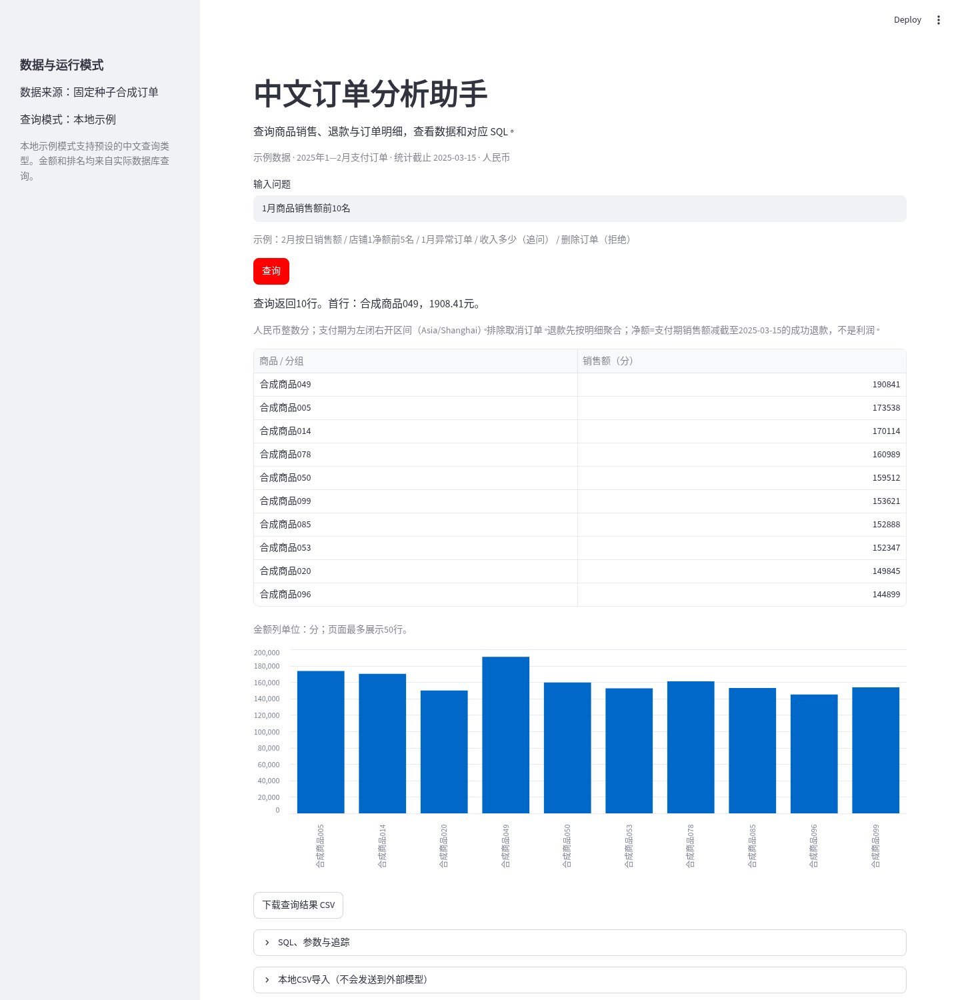
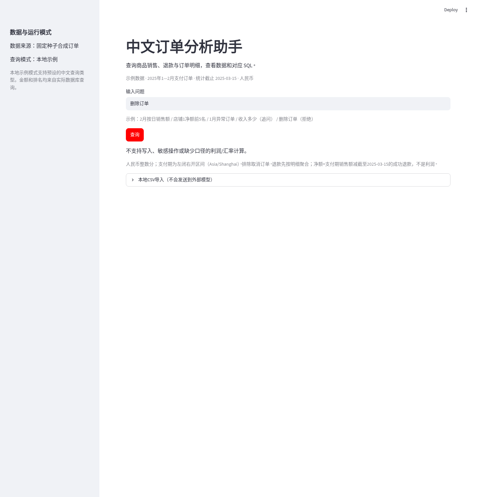

# 中文订单数据分析助手

用中文查询商品销售排行、退款、店铺汇总与订单明细，查看对应的数据表、图表和 SQL。支持 CSV 导入与结果下载，适合在本地处理个人订单数据。

项目使用 FastAPI、Streamlit 和 SQLite。提供本地示例模式与 DeepSeek 工具调用适配器；分析 SQL 统一经过解析、表白名单与 SQLite 只读授权检查。示例数据由固定种子生成，不包含真实客户信息。

## 运行截图

以下截图来自实际运行的页面，使用仓库生成的合成数据与本地示例模式。






## 快速开始

需要 Python 3.11 与 [uv](https://docs.astral.sh/uv/)。在项目目录执行：

```bash
uv sync --frozen --python 3.11
uv run python scripts/manage.py generate
bash scripts/start.sh
```

API 使用端口 8000，页面使用端口 8501，默认仅监听本机回环地址。按 Ctrl+C 停止；再次执行启动脚本会复用已有数据库。生成脚本拒绝覆盖已有文件。

可以从这些问题开始：

- `1月商品销售额前10名`
- `改成2月前3名`（沿用当前会话的指标）
- `店铺1净额前5名`
- `2月按日销售额`
- `1月退款排行`
- `收入多少`（澄清指标）

本地示例模式识别有限的问题模板，适合无密钥运行和检查数据口径；复杂条件需要核对生成的 SQL 与参数。

## 数据与指标

合成数据包含 100 个商品、1000 笔订单、2000 条明细，以及取消订单、部分退款和多次退款。支付日期为 2025 年 1—2 月，统计截止时间固定为 2025-03-15 零点。

|指标|计算口径|
|---|---|
|销售额|支付期内已支付明细实付，排除取消订单|
|销量|有效明细的商品数量|
|退款额|退款完成期内的成功退款|
|净额|支付期销售额减截至统计截止时间的成功退款；不是利润|

金额使用人民币整数分存储，展示金额使用 Decimal 转换。日期按 Asia/Shanghai 解释，区间左闭右开。退款先聚合到明细粒度再关联，避免多次退款重复累计销售额。未提供成本、手续费及汇率，不计算利润。

## CSV 导入与备份

四类模板位于 `data/sample/`，分别对应商品、订单、订单明细和退款。保持模板字段顺序，使用 UTF-8、整数分与带 `+08:00` 的时间。单表限制 2MB、10000 行。

页面提供预览与事务导入：预览会校验后回滚；正式导入前自动备份。相同记录跳过，冲突整批回滚，不静默覆盖。校验包含唯一键、外键、订单与明细金额一致性及退款上限。真实文件放入已忽略的 `data/private/`，勿提交到仓库。

```bash
uv run python scripts/import_data.py --directory data/private
uv run python scripts/import_data.py --directory data/private --commit
```

备份位于 `runtime/backups/`。恢复时先停止服务，保留当前数据库，再将所选备份复制为 `runtime/orders.db`，重启并检查 `/ready` 及汇总结果。备份包含完整订单数据，应保留在本地。

## DeepSeek 配置

在安全环境设置中配置 `DEEPSEEK_API_KEY`，并设置实际使用的 `DEEPSEEK_MODEL`。启用适配器需要明确同意将问题、必要上下文、结构和指标口径发送至 `api.deepseek.com`：

```bash
export ORDER_MODEL_MODE=deepseek
export ORDER_ALLOW_EXTERNAL=yes
bash scripts/start.sh
```

查询结果在本地生成摘要，不发送给模型。真实订单的提问与参数也可能包含敏感信息，启用前需确认数据去向。请核对供应商当前模型价格与账户额度；调用数量限制不等于人民币费用上限。没有密钥时保持默认的本地示例模式。

适配器最多执行 8 次工具调用，SQL 语法错误最多纠正两次；权限拒绝、超时或预算耗尽后停止。模型请求超时 10 秒，流程预算 30 秒。真实模型验证状态与费用记录见[验证记录](docs/验证记录.md)。

## 接口与查询边界

|接口|用途|
|---|---|
|`GET /health`|进程状态，不调用模型|
|`GET /ready`|数据库就绪检查，不调用模型|
|`POST /chat`|提交 `question` 与 `session_id`|
|`POST /imports`|CSV 预览或明确确认后的事务导入|
|`POST /model/test`|当前模型接入状态说明|

分析连接采用 SQLite URI `mode=ro` 与 `query_only`；SQLGlot 解析单条查询并检查 CTE、子查询和表引用，SQLite 授权回调限制函数、业务表及操作权限。禁止写入、系统表、PRAGMA 和扩展加载。

查询使用约 3 秒进度预算，最多返回 200 行、页面显示 50 行，并限制输出字节数。导出 CSV 转义公式前缀。进度回调不能替代操作系统内存配额，本项目面向本地单用户小数据，不应直接公开为通用 SQL 服务。

## 测试与复现

```bash
uv run ruff check .
uv run pytest -q
uv run python scripts/evaluate.py
```

当前本地结果：33 项测试通过，Ruff 通过；30 题本地示例评测通过，包含 20 题结果比较、5 题澄清、5 题拒绝。模型工具循环使用 MockTransport 独立测试，真实模型评测另行记录，不与本地结果混用。

已验证干净目录安装、数据生成、导入预览、真实 API 请求、Docker 内查询和备份恢复。详细证据及限制见[验证记录](docs/验证记录.md)，结构与关键模块见[设计与学习](docs/设计与学习.md)，参考资料见[来源](docs/来源.md)。

## 容器运行

先生成 `runtime/orders.db`，再运行 `docker compose up --build`。API 与页面分离，端口仅绑定主机回环地址；API 数据目录只读，容器模式页面导入禁用。独立导入服务拥有写入目录，默认仅预览：

```bash
docker compose --profile import run --rm importer
```

正式导入前停止 API，再追加命令 `python scripts/import_data.py --directory /input --commit`。镜像不内置密钥。Dockerfile 构建与容器内查询已经验证，Compose 组合启动未验证。

当前未进行公网部署与真实业务数据对账。公开部署前需要认证、TLS、限流及备份权限等额外措施。
