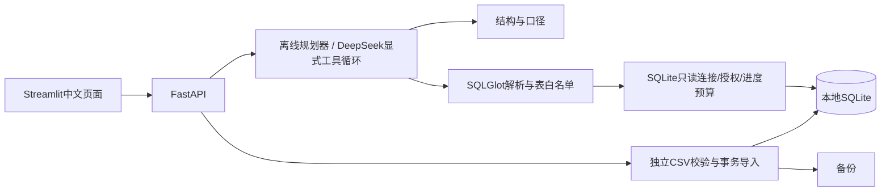

# 结构与学习

`db.py`负责结构与固定种子数据；`tools.py`是所有分析SQL的执行边界；`agent.py`保留有限筛选上下文并生成确定性回答；`provider.py`实现显式工具循环，不使用框架SQL执行器；`imports.py`单独写入；`api.py`组织接口，`ui/app.py`展示和导出。

增加指标：先定义时间归属、取消与退款口径，再写独立固定SQL和预期测试，然后增加规划规则/工具口径及评测样本。增加表必须同步结构生成、SQL白名单、授权边界、导入顺序和攻击测试，不能只改提示词。

离线规划器不是模型Agent：其路线固定，没有模型纠错。真实模型适配器会根据结构/口径工具结果生成SQL；语法错误最多纠正两次，权限或资源拒绝不继续纠正。摘要只使用实际返回的数据，不保存思维链。

常见定位：启动失败先查依赖和端口；ready失败查数据库路径及表；SQL拒绝查许可表和函数；金额不符先查支付期/退款期差异、取消订单和明细分摊；导入失败查模板顺序、时区和唯一键。不要为让查询通过而移除授权回调。

## 面试讲解

- 多次退款为什么会重复销售额？直接一对多JOIN会复制明细，先将退款聚合到明细主键再关联。
- 为什么只读URI还需要授权回调？URI限制数据库写入，授权回调进一步拦系统表、函数和管理操作，解析器提供提前反馈。
- 参数绑定解决什么？将值与语法分开；不能绑定表名，因此表和字段仍需许可结构与数据库授权。
- 如何避免模型编造数字？本地查询结果确定性渲染摘要；空结果明确说明，截断标记。
- 为什么LIMIT不能防大查询？聚合和笛卡尔积可能先扫描大量行，需进度预算；仍有内存边界限制。
- 如何评测？比结果及业务口径，不比SQL字符串；区分离线、Mock模型和真实模型，记录失败及用量。
- 费用如何控制？调用和token上限只是技术约束，真实人民币预算仍需核验当前价格与供应商额度。

## 待完善边界

真实模型选择、真实评测和人民币预算核验等待凭据及官方价格。离线自然语言解析为有限模板，复杂筛选/排序/日期须扩展并评测。按日图已按日期排序，尚未补齐无交易日期。模型模式会话数据版本校验与并发隔离仍需增强。公开部署前必须补认证、TLS、限流、备份权限及请求体限制。
